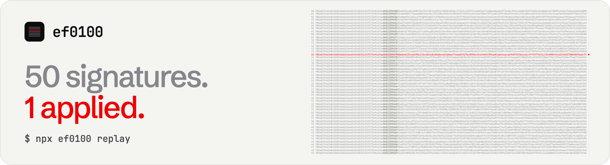

<p align="center">
  
</p>

<h3 align="center">Decode, replay and refuse EIP-7702 delegations.</h3>

<p align="center">
  <a href="https://github.com/ef0100dev/ef0100/actions/workflows/ci.yml"></a>
  <a href="LICENSE"></a>
  <a href="https://www.npmjs.com/package/ef0100"></a>
</p>

<p align="center">
  <a href="https://ef0100.xyz">ef0100.xyz</a> ·
  <a href="docs/incident-2026-10-29.md">The incident</a> ·
  <a href="docs/cli.md">CLI</a> ·
  <a href="docs/guard.md">Guard</a> ·
  <a href="docs/fixtures.md">Fixtures</a> ·
  <a href="CHANGELOG.md">Changelog</a> ·
  <a href="SECURITY.md">Security</a>
</p>

On 2026-10-29 a type-4 transaction carried 50 EIP-7702 authorizations, signed with an exchange hot wallet's key for 50
consecutive nonces. One of them matched the wallet's live nonce, and for 3h49m36s the wallet's code was
`0xef0100 ‖ 63e842…6fae`: a sweeper that moved 172,624.40 ETH and 1,819,724,910.57 USDT out of it, plus 823M USDC out
of a smart account it owned.

ef0100 is a TypeScript library and CLI built from the bytes of that day. It replays the drain offline from the raw
transaction, decodes any type-4 transaction against the state it ran on, scans wallets on 11 EVM chains, and puts a
guard in front of a signer that refuses what it cannot decode: no preimage, no signature.

```
$ npx ef0100 replay

ef0100 0.1.2 · replay 2026-10-29 · offline · fixtures sha256 ok

  tx       0xad99264d…ccd051298b · type 4 · block 26,300,753 · 20:20:59 UTC
  bytes    4,916 · keccak(raw) = tx hash
  signers  50/50 tuples recover to 0x28C6…1d60 (explorer label: Binance 14)
  nonce    0x28C6…1d60 at tx index 138: 18,914,809 → 18,914,810 at #15

  ···············█··································
  #0             #15                             #49
  15 ahead       1 applied           34 already used

  code     0x → 0xef0100 63e842b054bd624a465454d533c33f573e9c6fae
  sweep    +17 blocks · +204 s · 167,464.2479 ETH · 63 token transfers
  logs     the EOA emitted SweepItemFailed(2); EOAs don't emit logs
  own txs  ≤8 per block before · ≤1 per block for the 1,142 delegated
  top-ups  200,000,000 USDT swept in 72 s · 2,961.99 ETH swept in 60 s
  clear    +3h49m36s · self-sponsored · auth → 0x0 · 36,800 gas

  guard    REFUSE 50/50 authorizations · REFUSE 50/50 bare digests
           ALLOW 1/1 the clear

  50 signed. 1 applied.
```

The transaction, its 50 tuples and their verdicts, the clearing transaction, the sweeper's bytecode and the guard's
answers are recomputed from raw bytes bundled in the package. Blocks, times, amounts, the log, gas and the per-block
counts come from RPC and explorer records bundled next to them; [docs/fixtures.md](docs/fixtures.md) says which is
which. Nothing is fetched.

## Where it went

```
$ npx ef0100 replay --flows
  where the swept value went · first hop on Ethereum · snapshot 10-30 06:41:26 UTC

  R1  0x5227f603C1eE34CE3C06eFe6477003BDfCCB2f8c
  ├─◀ 169,534.00 ETH  1,819,724,910.57 USDT  +62 tokens 0x28C6…1d60 Binance 14, delegation
  ├─◀ 28,005.60 ETH  55,739,800.50 USDT  +7 tokens    0xDFd5…963d Binance 16, signed transfers
  ├─◀ 823,000,000 USDC                                0xEe7a…4055 its smart account, delegation
  ├─▶  195,460 ETH → 0x8532…43D4  10-29 20:38:47  0x551d…2c76  120 B decoded
  ├─▶    2,000 ETH → 0x8532…43D4  10-30 01:14:11  0x4818…e84a  120 B decoded
  ├─▶   17,260 ETH → 0x03b0…20ea  10-30 05:15:47  0x9edf…6071  113 B decoded
  ├─▶ 701 txs 10-29 20:29–10-30 05:15: SwapRouter02 357, UniswapV2Router02 159, +4 routers
  └─■ blacklisted by Tether 21:01:35, Circle 21:04:59 UTC

  R2  0xA97bF7836F8A08F9Ed91D41453D371493FAE8d10
  ├─◀ 3,090.40 ETH  +122 tokens                       0x28C6…1d60 Binance 14, delegation
  └─▶ 1,266 txs 10-30 01:17–10-30 06:36: SwapRouter02 427, UniswapV2Router02 403, +2 routers

  ◀ in, ▶ out. Each ETH transfer decodes from raw bytes bundled in the package; the
  transaction counts are a Blockscout snapshot; labels are explorer labels, not ownership.
```

Each ETH transfer above ships as its raw transaction and is checked against its hash, sender, recipient and value when
the data loads. The transaction counts are a dated snapshot, so they stop at the time shown.

## Commands

| Command | What it does |
|---|---|
| `npx ef0100 replay` | The drain from its own bytes, offline. `--table` for all 50 tuples, `--timeline` for the 3h49m36s, `--flows` for where the value went next. |
| `npx ef0100 <address…>` | Is any of these accounts delegated, on any of 11 EVM chains? Exit 0 clean, 1 delegated, 2 to a known-malicious or sweeper-like delegate. |
| `npx ef0100 watch <address>` | `scan` again every slot: one line, in UTC, the moment a delegation appears, changes or clears. `--exit-on-change` for scripts, `--webhook` for Slack or Discord. |
| `npx ef0100 decode <txhash\|raw>` | A type-4 transaction, tuple by tuple, against the state it ran on: the nonce at the end of the previous block plus every earlier transaction in the same block. Raw bytes are looked up by their hash, on the chain they name. |
| `npx ef0100 classify <hex>` | What a key is being asked to sign (EIP-7702 authorization, set-code transaction, typed transaction, EIP-712, personal message, bare digest), and whether the guard would sign it. |
| `npx ef0100 recipient <address>` | Should funds go to this address now? Holds transfers to a delegated, contract or USDT/USDC-blacklisted address. Blacklists are read on Ethereum, Arbitrum, Avalanche, Polygon, Base and Optimism; elsewhere it says they were not checked. |
| `npx ef0100 clear <address>` | The unsigned, self-sponsored type-4 transaction that clears a delegation. |
| `npx ef0100 code <address>` | What a delegate's bytecode does, read statically: selectors (including ones the optimizer stored shifted), hardcoded addresses, and a sweeper-like heuristic that is a hint, not a verdict. |
| `npx ef0100 sol <signature>` | A Solana transaction before signing: durable nonces, Assign, SetAuthority, Approve, stake authorities, loader upgrades, Squads vault messages. |
| `npx ef0100 sol nonces <pubkey>` | Every durable-nonce account a key controls: the signatures that never expire. |
| `npx ef0100 oracle` | Signs the 32-byte digest of tuple #15 with a public test key and reads it back as a valid authorization. |
| `npx ef0100 guard test` | The guard against the incident's tuples, digests, rehearsal tuples and the wallet's own clear. |

The full reference, with flags and exit codes, is in [docs/cli.md](docs/cli.md).

## The guard

A signer that is handed 32 bytes cannot tell an EIP-7702 authorization from anything else: the `0x05` that marks it is
inside the hash. ef0100's guard decides from the bytes it is asked to sign, never from a description of them.

```ts
import { Guard, profiles } from "ef0100";

const guard = new Guard(profiles.hotWallet);

// A raw-digest signer (KMS DIGEST, Web3Signer with applyHash=false, a sign(hash) API) gets the preimage alongside.
const decision = guard.checkDigest(digest, preimage, { signer, nonce, ownCode });
if (!decision.allow) throw new Error(decision.reasons.map((r) => r.code).join(", "));
```

- **Bare digests are refused** (`NO_PREIMAGE`). With the preimage, the guard checks `keccak256(preimage) = digest` and
  judges the preimage.
- **Authorizations** need the key they bind and its live nonce in the context (`CONTEXT_MISSING` otherwise), an
  allowed delegate (`DELEGATE_NOT_ALLOWED`), a real chain id (`WILDCARD_CHAIN_ID`), the live nonce itself
  (`NONCE_NOT_LIVE`; live + 1 when self-sponsored), and at most `maxPerWindow` delegating authorizations per key
  (`RATE_LIMITED`; clears do not count, and a tuple the guard already allowed is not counted again).
- **Set-code transactions** carrying another account's tuples are refused unless the key is meant to relay
  (`SPONSORS_OTHER_AUTHORITY`), and at most 16 tuples are recovered (`TOO_MANY_TUPLES`).
- **Once the key's own account has code** (`ownCode`), the guard signs only a self-clear sent to itself with no value
  and no calldata, plus break-glass evacuation: plain ETH to a cold address you list, or `transfer(cold, amount)` on a
  token you list (`OWN_CODE_PRESENT`).
- **The hot-wallet profile signs transactions only**: no EIP-712 (a permit is EIP-712), no personal messages, no legacy
  transaction without a chain id (`NO_CHAIN_ID`), and no 32-byte input that merely parses as a transaction.

Details and every reason code: [docs/guard.md](docs/guard.md).

## The library

```ts
import { decodeTransaction, processAuthorizationList, analyzeAuthorizationList } from "ef0100";

const tx = decodeTransaction(rawHex); // legacy, 2930, 1559, 4844 and 7702, with the sender recovered
const result = processAuthorizationList(tx, {
  chainId: 1n,
  state: (authority) => ({ nonce: 18_914_809n, code: "0x" }),
});
result.applied; // [{ index: 15, status: "applied", effect: "delegate", ... }]
analyzeAuthorizationList(tx, { watch: [hotWallet] }); // NONCE_SPRAY, KNOWN_MALICIOUS_DELEGATE, WATCHED_AUTHORITY, ...
```

`processAuthorizationList` replays a list the way clients do: in order, after the sender's nonce is bumped, skipping
every tuple that fails a check without reverting, and moving the authority's nonce on with each tuple that applies.
`ef0100/incident` (Node only) loads the bundled 2026-10-29 data.

## What it does not do

- **It has not been audited.** See [SECURITY.md](SECURITY.md).
- **It cannot stop a stolen key.** Whoever holds the raw key signs without asking anyone.
- **It does not claim it would have stopped this drain.** How the 50 signatures were produced is not public. The claim
  is narrower: if ef0100 sits in the signing path, it refuses these signatures.
- **The guard test is a regression fixture, not a benchmark.** The hot-wallet profile refuses the 50 tuples because it
  allows no delegate at all; that is deny-by-default working, not evidence that a rule told good from bad.
- **Plain transfers need destination and template rules.** On the chains traced transaction by transaction, every
  other leg of the drain was an ordinary signed transfer (Arbitrum, Base and Polygon outflows were not traced one by
  one). On Solana, `ef0100 sol --template` flags a hot wallet's transfer that skips its own durable-nonce pool.

## How the numbers are checked

- Every bundled raw transaction hashes to its own transaction hash, and every file under `fixtures/` is listed in a
  `SHA256SUMS` that the CLI checks before it prints and CI checks on every push.
- Decoding, authority recovery and signatures are cross-checked against [viem](https://viem.sh) in the test suite.
- The bundled clearing transaction is rebuilt byte for byte by `planClearDelegation()`.
- Every bundled Solana transaction verifies its own ed25519 signature.
- The wallet's block-by-block history matches archive-node nonces at the points the tests check, and its nonce advances
  without a gap except in the two blocks where an authorization used one.

What each file proves, and what only an RPC or an explorer attests, is in [docs/fixtures.md](docs/fixtures.md).

## Your own RPC

The live commands use keyless public endpoints by default. To use your own, set `EF0100_RPC_<CHAIN>` (for example
`EF0100_RPC_ETHEREUM`, `EF0100_RPC_BASE`, `EF0100_RPC_SOLANA`) or pass `--rpc <url> --chain <key>`. Your endpoint is
tried first, for live and historical reads alike. Error messages print an endpoint's host only, and text that comes
back from an endpoint is stripped of terminal control characters before it is printed.

## Install

```sh
npx ef0100 replay        # no install
npm install ef0100       # the library, Node 22.12 or later
```

Runtime dependencies: `@noble/curves`, `@noble/hashes` and `@scure/base`, pinned to exact versions. Nothing runs at
install time.

## License

MIT. See [LICENSE](LICENSE).
